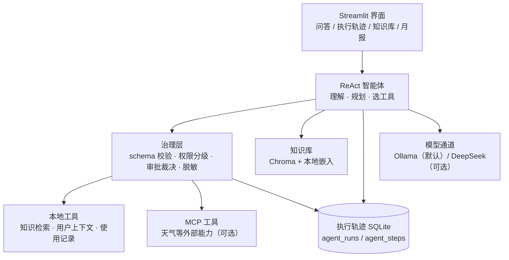

# 扫地机器人智能客服 · Agent 执行治理

> 面向扫地机器人售后场景的智能客服：能答、能查、能在边界内代办，拿不准就交给人。


-000000)

## 这个项目解决什么

智能硬件的售后咨询重复度很高：耗材怎么换、故障怎么排、地址能不能改、耗材能不能补发。只会聊天的机器人答得了问题却办不了事，直接放手让它办又有风险。

这里的做法是把"答"和"办"分开：知识库负责给依据，ReAct 智能体负责理解问题和挑工具，治理层负责边界——读、写、危险动作分三档，危险动作必须有人确认才执行，办不了的转人工。

## 功能概览

| 能力 | 说明 |
| --- | --- |
| 知识问答 | 产品手册、FAQ 等资料入库后检索作答，回答带引用依据 |
| 工具调度 | ReAct 循环：理解问题 → 选工具 → 读结果 → 继续或作答 |
| 工具注册表 | 每个工具声明入参 schema、权限级（read / write / risk）、超时与重试策略，调用前统一校验 |
| 人工确认闸门 | 高风险工具未获批准一律不执行，记入轨迹，由界面提示确认 |
| 执行轨迹 | 每次 run 与每一步落库（状态、工具、脱敏入参、耗时、审批结论），可在页面逐幕回看 |
| 循环与资源保护 | 最大步数、单次总时长、重复调用阈值，超限优雅收尾或降级，不假装成功 |
| 知识库管理 | 上传资料、重建索引，查看文档与切分结果 |
| 使用月报 | 按月汇总使用记录，生成报告 |
| MCP 适配 | 天气等外部能力经 stdio MCP 接入，未配置时返回受控错误，不影响其余功能 |

## 整体架构



执行状态机把一次对话拆成明确阶段：规划、执行、等待工具、等待审批、观察、汇总、结束；失败、降级、超步各有终态，非法转移直接抛错，便于单测与排查。

## 技术栈

| 层 | 选型 |
| --- | --- |
| Agent | LangChain ReAct 循环 + 自研状态机与治理中间件 |
| 模型 | 本地 Ollama（默认）；DeepSeek 云端为可选备选 |
| 嵌入 | 本地 Ollama 嵌入模型，资料不出本机 |
| 向量库 | Chroma（持久化，可重建） |
| 持久化 | SQLite（会话、消息、月报、执行轨迹） |
| 界面 | Streamlit 多页应用 |
| 外部工具 | MCP（stdio）适配层 |

## 目录结构

```
.
├── app.py                     # 入口：问答页
├── pages/                     # 执行轨迹 / 知识库管理 / 使用报告
├── agent/
│   ├── react_agent.py         # ReAct 主循环与 run 生命周期
│   ├── state_machine.py       # 执行状态机（纯逻辑，可单测）
│   ├── registry.py            # 工具声明、权限、审批裁决、脱敏
│   ├── tool_registry.py       # 默认注册表装配
│   ├── trace.py               # 执行轨迹落库
│   ├── mcp/                   # ToolProvider 抽象与 stdio 客户端
│   └── tools/                 # 本地工具、治理中间件、高风险模拟工具
├── rag/                       # 检索与报告服务
├── model/                     # 模型工厂（本地 / 云端切换）
├── config/                    # 配置与提示词
├── scripts/                   # 建库、重建知识库
├── tests/                     # 状态机、治理、注册表、轨迹、MCP 契约
├── data/                      # 种子资料（产品手册、FAQ、使用记录样例）
└── requirements.txt / Dockerfile / start.ps1
```

## 快速开始

前置：安装并启动 Ollama，拉取对话与嵌入模型。

```powershell
ollama pull qwen3.5:9b
ollama pull qwen3-embedding:4b
```

```powershell
python -m pip install -r requirements.txt
copy .env.example .env
python scripts/init_db.py
python scripts/rebuild_knowledge.py --full
python -m streamlit run app.py --server.port 8513
```

也可以直接运行 `.\start.ps1`（会检查 `.env`、建库并启动）。默认地址 `http://localhost:8513`。

## 配置

`.env` 从 `.env.example` 复制，关键项：

- `MODEL_PROVIDER`：`ollama`（默认）或 `deepseek`
- `OLLAMA_BASE_URL` / `OLLAMA_MODEL` / `OLLAMA_EMBED_MODEL`
- `DEEPSEEK_API_KEY`：仅切换云端时需要，留空即全本地
- `WEATHER_MCP_SERVER`：可选天气 MCP server 的 server.py 路径；不配置则天气工具返回受控错误
- `WEATHER_API_TOKEN`：天气上游令牌（可选）

`.env` 已在 `.gitignore` 中，请勿提交任何真实密钥。

## 设计取舍

- **能办与不能办分开**：工具注册表先声明权限与审批要求，再由治理层裁决，避免把"是否安全"交给模型自觉判断。
- **执行可回放**：每一步都落库，失败时能定位到具体哪一步、哪个工具、什么入参（已脱敏）。
- **失败必须可见**：工具重试后仍失败就降级为兜底观察，不把异常抛给模型，也不包装成成功。
- **资源上限显式化**：步数、时长、重复调用三类阈值都在配置里，超限即收尾。
- **外部能力走协议**：MCP 适配层让本地函数与远程工具对上层同一接口，换实现不改治理与 Agent。

## 已知限制

- 高风险工具（报修派单、重置设备、下单耗材）为模拟实现，不对接真实业务系统。
- 本地部署、无登录鉴权，多用户按用户 ID 隔离，适合本机或内网使用。
- 天气依赖外部 MCP server 与上游令牌；未配置时该工具只返回受控错误。
- 云端模型通道需要自备密钥，默认路径为全本地。
